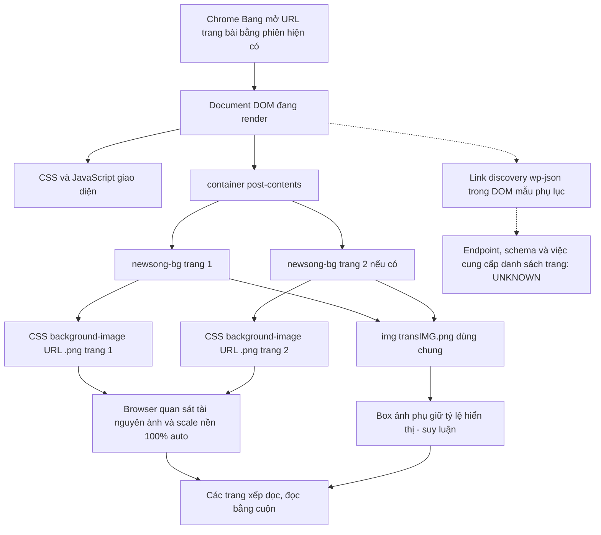

# AudioTP — Khảo sát kỹ thuật hiển thị BookVN

Ngày: **12/10/2026, Asia/Bangkok**. Phạm vi: 5 trang bài đại diện, đọc DOM/computed CSS và inventory tài nguyên có sẵn khi duyệt bình thường trong **Chrome profile Bang**, được người dùng xác nhận trước đây là Profile 4. Không tải/lưu/chụp bản nhạc, không viết downloader, không sửa website/catalog/audio/R2.

**Kết luận:** vùng bản nhạc của 5 mẫu dùng các khối CSS background-image có URL `.png`, không có lớp nốt/lời HTML hay vector riêng được quan sát. Bài nhiều trang dùng nhiều khối xếp dọc. **PDF gốc: NOT OBSERVED trong các mẫu; sự tồn tại ở nơi khác: UNKNOWN.** Có link discovery WordPress API trong DOM của mẫu phụ lục, chưa kiểm tra endpoint hoặc schema.

## 1. Phương pháp, ngữ cảnh và giới hạn DevTools

Đã đọc `bookvn-pdf-analysis.md`, `docs/sheet-implementation-report.md`, `docs/score-viewer-benchmark.md`, `docs/sheets-windows.md` và `docs/windows-app-architecture.md`. Không tìm thấy AGENTS.md/SETUP.md trong workspace hoặc các thư mục cha đã kiểm tra; áp dụng AGENTS do người dùng cung cấp. Không khảo sát lại danh mục 542 mục hay chạy lại matching/benchmark.

Inventory Browser Use trả đúng một Chrome profile **Bang**; chỉ dùng browser này và tab BookVN người dùng đã mở. Browser ID hiện tại `1` là ID runtime, **không phải số Chrome Profile**. Không dùng tab YouTube hoặc profile khác. Kết thúc đã reset viewport override và trả tab về bài 1 ban đầu.

Khả năng công cụ đã kiểm tra:

| Bề mặt | Khả năng thực tế trong phiên | Giới hạn |
|---|---|---|
| Elements/DOM | Đọc phần tử, thuộc tính, text trong vùng bản nhạc | Không xuất toàn bộ HTML/account/session |
| Computed CSS | background-size/image, border, margin, kích thước box, transform, zoom | Không đọc toàn bộ stylesheet source |
| Asset inventory `pageAssets.list()` | URL, loại tài nguyên, nguồn phát hiện `resource`/`attribute`/`computedStyle` | Không có response headers, bytes, status hay body |
| Responsive viewport | Override tạm 640×900 và 1280×900, rồi reset | Đây là resize, không phải kiểm thử browser zoom/pinch |
| F12 GUI / Network / Sources | **Không có API DevTools Network/Sources trong các capability được cấp; native computer APIs bị tắt** | Chưa mở/đọc được GUI F12; chưa đọc HTTP Headers, Initiator stack hoặc JavaScript source |

Đây là **khảo sát bằng các khả năng quan sát thụ động được hỗ trợ**, không phải capture Network F12 hoàn chỉnh. Không cài thêm debugger, mở cổng debug, dùng CDP ngoài API được cấp, tắt sandbox hoặc tìm đường vòng. Không gọi `pageAssets.bundle()`, fetch/HEAD trực tiếp asset, tạo Image để lấy kích thước nền, gọi API, đọc cookie/storage/Authorization hay xuất HAR. DOM inspection chỉ phục vụ 5 mẫu cụ thể, không phải script thu thập kho tài liệu.

Nhãn bằng chứng trong báo cáo:

- **OBSERVED:** dữ liệu trả trực tiếp từ DOM/CSS/inventory.
- **INFERRED:** cách giải thích phù hợp quan sát, chưa chứng minh implementation bên trong.
- **NOT OBSERVED:** chưa thấy trong phạm vi kiểm tra; không đồng nghĩa không tồn tại.
- **UNKNOWN:** công cụ/phạm vi không đủ để xác minh.

## 2. Mẫu đã mở và cấu trúc tài liệu

| Trang bài | Nhóm | Khối ảnh nền | URL asset đọc từ CSS, dưới `https://bookvn.net` |
|---|---|---:|---|
| [Bài 1](https://bookvn.net/newsong/newsong1/) | main | 1 | `/wp-content/uploads/2023/02/nsv-001-1.png` |
| [Bài 100](https://bookvn.net/newsong/newsong100/) | main | 2 | `/wp-content/uploads/2023/03/nsv-100-1.png`; `/wp-content/uploads/2023/03/nsv-100-2.png` |
| [Bài 485](https://bookvn.net/newsong/newsong485/) | main | 1 | `/wp-content/uploads/2023/03/nsv-485-1.png` |
| [appx001](https://bookvn.net/newsong/newsong-appx001/) | appx | 1 | `/wp-content/uploads/2024/10/nsav-001-1.png` |
| [Phụ lục 1](https://bookvn.net/newsong/newsong-appendix1/) | numbered-appendix | 2 | `/wp-content/uploads/2018/11/nsav-001-2-1.png`; `/wp-content/uploads/2018/11/nsav-001-2-2.png` |
| **Tổng phạm vi lần này** | **5 trang bài** | **7 khối / 7 URL ảnh nền khác nhau** | Không phải thống kê toàn kho |

Số khối và URL nhất quán với khảo sát trước. Lần này bổ sung computed CSS, dimensions của phần tử phụ, inventory trước/sau cuộn và responsive; không dùng kết quả này để cập nhật snapshot/catalog.

DOM mẫu quan sát được, chỉ phần cấu trúc không có bytes tài liệu:

```html
<div class="container post-contents">
  <div class="newsong-bg"
       style="background-image:url('/wp-content/uploads/2023/03/nsv-100-1.png')">
    
  </div>
  <div class="newsong-bg"
       style="background-image:url('/wp-content/uploads/2023/03/nsv-100-2.png')">
    
  </div>
  <!-- Mục Lục -->
</div>
```

Trong cả 5 mẫu: mỗi `.newsong-bg` có textContent rỗng sau trim; vùng `.post-contents` chỉ có text **Mục Lục**, không có lời bài hát được tách thành HTML. Số SVG/canvas/iframe/embed/object trong vùng này đều **0**. Không thấy PDF viewer hoặc text overlay. Logo của website có URL SVG; **SVG logo không phải vector bản nhạc**.

## 3. Sơ đồ tải và hiển thị



Các URL nền có cả dấu vết `resource` và `computedStyle.background-image` trong inventory. Sơ đồ không khẳng định URL được chèn bởi server hay JavaScript: chưa có HTML Response/Sources để phân biệt. Không có bằng chứng cần một API riêng để giải thích DOM hiển thị hiện tại; điều này không chứng minh website không có API.

## 4. Tài nguyên đã quan sát và giới hạn Network

| Loại trong inventory | Mẫu 1 trang nhạc | Mẫu 2 trang nhạc | Ví dụ / nguồn quan sát |
|---|---:|---:|---|
| Image | 4 | 5 | 1/2 ảnh bản nhạc nền + transIMG.png + logo.svg + ico_alert@2x.png |
| Stylesheet | 9 | 9 | theme `watv/style.css`, `css/style2.css`, WDS/grid/fontello và plugin CSS; một CSS từ `wds.watv.org` |
| Script | 7 | 7 | jQuery, jQuery Migrate, common.js, hai file Headroom, Site Kit events và WP emoji |
| Font | 1 | 1 | `fontello.woff2`, nguồn `resource/css` |
| Other / video | 0 / 0 | 0 / 0 | Không có mục thuộc các loại này trong inventory mẫu |
| Inline SVG | 0 | 0 | Logo SVG là file image bên ngoài |
| **Tổng inventory** | **21** | **22** | Không phải số HTTP request đầy đủ |

Inventory hợp các nguồn DOM/computed-style/resource và deduplicate URL; document điều hướng không xuất hiện trong bảng này. Không suy ra HTTP status, MIME, response size, hit cache hoặc số request on-wire từ các số 21/22. Không cộng các inventory thành tổng request phiên vì tài nguyên chung lặp giữa trang bài. Chỉ ghi đường dẫn kỹ thuật cần thiết, bỏ query string; không lưu toàn bộ DOM hoặc URL tài khoản.

### MIME, bytes, cache và kích thước thật

| Thuộc tính | 7 URL nền bản nhạc | transIMG.png | Mức xác minh |
|---|---|---|---|
| Loại được browser inventory phân loại | image | image | OBSERVED |
| Hậu tố URL | `.png` | `.png` | OBSERVED; không thay thế Content-Type hoặc magic bytes |
| HTTP Content-Type | UNKNOWN | UNKNOWN | Không có response headers |
| Content-Length / encoded / transferred bytes | UNKNOWN | UNKNOWN | Không đo/không tải lại để đo |
| Cache-Control, ETag, Last-Modified, Expires, Age | UNKNOWN | UNKNOWN | Không suy đoán mặc định WordPress/CDN |
| Cache hit, 304, memory/disk cache | UNKNOWN | UNKNOWN | Không có Network log/Resource Timing bytes |
| Natural width × height | **UNKNOWN** | **2479×3508 px** | Chỉ `` phụ có metadata DOM này |
| Nội dung pixel/độ trong suốt | Chưa đọc | Chưa đọc | Không lưu/chụp/giải mã bytes tài liệu |

URL bản nhạc không có query ký thời hạn trong các giá trị CSS đã đọc; **không chứng minh URL công khai, vĩnh viễn hoặc không cần auth**. Không thử truy cập ngoài phiên hoặc direct asset. Tên tệp `.png` và cơ chế ảnh nền phù hợp hiển thị raster, nhưng chưa xác minh MIME/định dạng on-wire nếu server có chuyển đổi ảnh.

### API metadata: dấu hiệu mới và điều chưa biết

Ở DOM `<head>` của **Phụ lục 1** đã thấy:

```html
<link rel="https://api.w.org/" href="https://bookvn.net/wp-json/">
```

Đây là cơ chế discovery REST API của WordPress theo [tài liệu chính thức](https://developer.wordpress.org/rest-api/using-the-rest-api/discovery/). **OBSERVED: link khai báo root API. UNKNOWN: endpoint hoạt động, quyền truy cập, namespace, schema bài viết, danh sách trang/asset và điều kiện dùng API.** Không thấy link `application/json` cụ thể cho bài trong truy vấn DOM mẫu này, không gọi root hoặc đoán route bài viết.

Không quan sát được request fetch/XHR metadata bài/danh sách trang trong inventory của các mẫu; `other=0` không đủ để tuyên bố không có API. Link discovery không phải bằng chứng request API đã phát sinh. Không kiểm tra/xuất cấu hình inline có thể chứa dữ liệu phiên. Không giả định API root cho phép lấy hoặc phục vụ lại tài liệu.

## 5. Hiển thị nhiều trang, lazy loading và responsive

**OBSERVED, bài 100:** hai `.newsong-bg` theo DOM order 1→2, xếp dọc. Trước cuộn, trang 2 bắt đầu ở **y=1589,234375 CSS px**, bên dưới document viewport cao **1009 px**. Dù chưa cuộn tới, inventory đã có cả `nsv-100-1.png` và `nsv-100-2.png` với nguồn `resource/css`. Sau cuộn End, hai URL và tổng inventory vẫn giữ nguyên. **Không thấy việc trì hoãn tải trang 2 tới lúc cuộn trong phép thử này.** Không suy rộng thành mọi trang/phiên không bao giờ lazy load.

**OBSERVED, phụ lục 1:** cũng có hai khối với hai URL riêng; cả hai đã có dấu vết resource ngay khi mở. Không cần bấm Next để hiển thị trang 2. Trong mẫu không có pagination tài liệu, chỉ cuộn và link quay về Mục Lục. Không dùng tên file để suy ra số trang chưa quan sát.

CSS nền quan sát: `background-size: 100% auto`, `background-repeat: no-repeat`; bài 1 còn xác minh `background-position: 50% 50%`. Ở phụ lục 1, khối có border **1px solid rgb(119,119,119)**, margin-bottom **15px**, position static, transform none, computed zoom 1.

| Bài 100, viewport thử | Khung `.newsong-bg` mỗi trang (CSS px) | Nguồn ảnh |
|---|---|---|
| Ban đầu, document client 1905×1009 | 900 × 1272,734375 | Hai URL `.png` đã nêu |
| Override 640×900 | 562,5 × 795,140625 | Không đổi URL, inventory vẫn 22 |
| Override 1280×900 | 900 × 1272,734375 | Không đổi URL, inventory vẫn 22 |

Viewport override bao gồm ảnh hưởng layout/scrollbar; không gọi 562,5 là kích thước file ảnh. Trên cả hai cỡ thử, background-size vẫn `100% auto`, không thấy thêm biến thể ảnh trong inventory. Các `` phụ không có srcset/sizes/loading/data-src ở các trường đã kiểm tra; không có `image-set()` trong computed background của mẫu thử. **NOT OBSERVED: đổi nguồn theo viewport**; chưa kiểm tra DPR khác, browser zoom, mọi breakpoint hoặc logic JavaScript bên trong. Viewport override đã reset trước khi kết thúc.

**INFERRED:** transIMG.png có thể là ảnh phụ giữ tỷ lệ và nằm trên background. Bằng chứng: cùng src và natural 2479×3508 ở mọi khối, max-width 100%, chiều cao hiển thị đi theo chiều rộng. Ở layout rộng, box ảnh phụ khoảng **897,984×1270,734 CSS px**; ở override hẹp bài 100 khoảng **560,484×793,141**. Ảnh phụ có alt rỗng; ở phụ lục 1 computed opacity 1, visibility visible, pointer-events auto, display inline. Chưa đọc pixels để chứng minh trong suốt hoặc mục đích chống sao chép; không gán kích thước natural của ảnh phụ cho bản nhạc nền.

## 6. Chất lượng, zoom và phương thức cung cấp tài liệu

- Không có nốt/lời HTML/vector độc lập trong vùng bản nhạc 5 mẫu. Fontello phục vụ giao diện không chứng minh lời bài hát là web font. Bản nhạc theo cơ chế ảnh nền nên chưa có bằng chứng tương đương phương án C SVG + HTML Text của benchmark AudioTP.
- Không thấy nút zoom, tải, in hoặc xuất PDF trong vùng tài liệu. Truy vấn toàn document ở Phụ lục 1 cho PDF links/download attributes/PDF objects trả 0; buttons chỉ là Search/Submit của header. Không gọi Chrome Print/Save as PDF: tính năng browser đó không chứng minh website cung cấp PDF gốc.
- Đã đo responsive fit theo bề rộng; **chưa thực hiện/đo browser zoom hoặc pinch**, chưa chụp/đánh giá nét nốt/chữ bằng ảnh lưu. Computed zoom=1 không phải bằng chứng mọi tính năng zoom đều bị cấm.
- **INFERRED từ mô hình raster:** phóng lớn một ảnh không bổ sung thông tin vector. Chưa biết natural resolution của ảnh chứa nhạc, nên không đưa giới hạn zoom tối đa, DPI, chất lượng in, kích thước bytes hay điểm chất lượng giả. Việc CSS scale width với height auto phù hợp quy tắc [background-size](https://developer.mozilla.org/en-US/docs/Web/CSS/Reference/Properties/background-size).
- URL `/newsong/.../` là trang bài; URL `/wp-content/uploads/...png` là tài nguyên hiển thị theo CSS; **nguồn PDF gốc chưa xác định**. Không đổi đuôi file hoặc thử đường dẫn suy đoán.

Điều kiện footer đã đọc ở bài 100 và Phụ lục 1:

> Cấm tải về, chụp, phân phát mọi tài liệu.

Footer ghi chủ thể bản quyền World Mission Society Church of God. Báo cáo chỉ ghi nhận thông báo, không xác nhận một giấy phép lưu/chuyển đổi/phục vụ riêng. Dùng cá nhân không được chuyển thành trạng thái quyền confirmed trong catalog. Không thử context menu, kéo/lưu ảnh, vô hiệu hóa listener, DRM/auth hoặc kỹ thuật bảo vệ; cũng không khẳng định website có DRM cụ thể khi chưa quan sát được.

## 7. Những kỹ thuật có thể áp dụng cho AudioTP.exe

Đây là đề xuất thiết kế từ quan sát và [benchmark fixture tự soạn](score-viewer-benchmark.md), không phải quyền sao chép tài liệu hoặc mã BookVN:

1. **Tách trang bài khỏi file/trang hiển thị.** Một source/edition có ordered pages với ID/pageNumber, format, dimensions đã xác minh, bytes/hash và provenance; không đoán trang theo filename hoặc DOM index thay cho định danh catalog.
2. **Giữ tỷ lệ responsive.** Khi có tài liệu được phép, lấy dimensions từ file thật hoặc metadata hợp lệ rồi giữ aspect ratio. Không dùng helper image khác để khai báo natural resolution. Với nội dung chính, ưu tiên img/viewer có mô tả và trạng thái lỗi, thay vì nền CSS không có lớp lời accessible.
3. **Lazy loading và cache có kiểm soát.** AudioTP nên tiếp tục cách page-on-demand/bounded cache đã thử với fixture; không cần sao chép cách tải sẵn cả hai background quan sát ở BookVN. Tải/giải mã trang đang xem, prefetch hạn chế nếu policy cho phép; giữ thứ tự/edition và không lấy cả thư viện.
4. **Chọn renderer theo file nguồn.** PDF gốc giữ nguyên để zoom/in khi được phép; ảnh dùng viewer raster và derivative WebP nếu quyền convert cho phép; SVG/HTML chỉ khi có nhạc/vector có cấu trúc thật. BookVN DOM hiện không cung cấp bằng chứng nguồn vector/text để tự tạo C chính xác.
5. **Đo native riêng.** Chuẩn bị fixture có kích thước/độ phức tạp được cấp quyền tương tự, kiểm tra fit/zoom/DPR/đa trang trong WebView2. Không mang số đo Chrome có nhiễu scheduling thành cam kết AudioTP.exe.
6. **Cache/quyền tách riêng khỏi catalog.** Cache theo source/edition/content hash và phạm vi user; xác minh response MIME/hash khi importer được phép chạy. Header BookVN đang UNKNOWN không làm cơ sở đặt TTL hay public cache cho AudioTP. Giữ credential ở server/native vault theo kiến trúc đã đề xuất, không lấy phiên Chrome làm credential importer.

Chưa sửa renderer/prototype hay triển khai các đề xuất trong khảo sát này.

## 8. Bước tiếp theo cho nguồn được phép

Ưu tiên nguồn PDF/vector hoặc bộ ảnh được chủ sở hữu cung cấp kèm metadata/thứ tự trang/ấn bản và phạm vi store/convert/serve/upload rõ ràng. Giữ review tác phẩm/audio độc lập với review quyền. Có thể tiếp tục dùng pipeline **file local được phép** đã kiểm thử, không cần downloader BookVN.

Nếu cần hoàn tất phần HTTP còn thiếu, một phiên **DevTools GUI trong đúng profile Bang** có thể đọc thủ công request do mở trang bình thường. Chỉ ghi whitelist: Content-Type, kích thước transferred/resource, Cache-Control, ETag, Last-Modified, status và nguồn cache. Không xuất HAR, request headers, cookie/Set-Cookie, tài khoản hoặc session URLs; không screenshot bản nhạc. Chưa thực hiện bước này và không yêu cầu thao tác đó để hoàn thành báo cáo hiện tại. Network panel có thể đọc headers/size của từng resource theo [hướng dẫn Chrome chính thức](https://developer.chrome.com/docs/devtools/network/).

Một API được nhà cung cấp cho phép có thể là đường nhập metadata tương lai, nhưng cần hợp đồng/schema/phương thức truy cập chính thức trước; **không tự gọi `/wp-json/` hoặc đoán route từ link discovery trong bước này**. URL ảnh hiển thị không được tự coi là nguồn nhập có quyền.

Ma trận bàn giao:

| Câu hỏi | Kết quả |
|---|---|
| Đúng Chrome Profile 4? | CONNECTED: Bang, theo xác nhận người dùng; không dùng profile khác |
| Renderer bản nhạc? | OBSERVED: CSS background images, URL `.png`; không thấy vector/text layer |
| Nhiều trang? | OBSERVED: khối xếp dọc, bài 100 và phụ lục 1 mỗi bài 2 khối |
| Lazy loading? | NOT OBSERVED trong phép thử trang 2; tài nguyên đã có trước cuộn |
| Responsive source variants? | NOT OBSERVED ở override 640/1280; chưa kiểm tra mọi DPR/breakpoint |
| MIME/bytes/cache headers? | UNKNOWN, không có DevTools Network API |
| Natural size của bản nhạc nền? | UNKNOWN; 2479×3508 thuộc transIMG.png |
| PDF gốc? | **NOT OBSERVED** trong mẫu; tồn tại ngoài mẫu **UNKNOWN** |
| API metadata/trang? | OBSERVED discovery link ở mẫu phụ lục; endpoint/schema/requests **UNKNOWN/NOT OBSERVED** |
| Nguồn tải chính thức/quyền nhập? | NOT OBSERVED / chưa xác nhận |
| Downloader mới hoặc file BookVN đã lưu? | **0 / 0** |

**Chỉ tạo `docs/bookvn-devtools-analysis.md`.** Không sửa snapshot, catalog, audio, manifest, state, credentials hoặc cấu hình R2. Không chạy FFmpeg/B10, không upload; không tạo ảnh/PDF BookVN hay script khảo sát hàng loạt. Tài liệu tham khảo công khai Chrome/WordPress/MDN chỉ giải thích cơ chế chung, không thay thế bằng chứng HTTP của BookVN.
