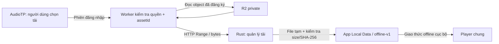
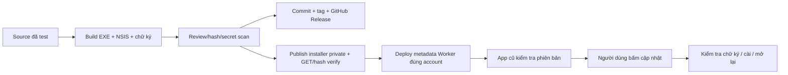

# AudioTP — Nghe offline và cập nhật Windows

Tài liệu cho đợt nâng cấp Offline Downloads & Startup Updates. Trạng thái nghiệm thu và artifact thực tế sẽ được ghi trong báo cáo của đợt phát hành; các mô tả kiến trúc dưới đây không thay thế bằng chứng đã cài/chạy trên máy Windows khác.

## Sử dụng

Trong ứng dụng Windows, kết nối thư viện để tải lần đầu. Icon tải bên cạnh trái tim tải riêng bài đó. Nút **Tải về** dưới Bộ lọc cho chọn nhóm hiện tại hoặc toàn bộ danh mục. Hộp xác nhận ghi số bài còn thiếu và dung lượng; bài đã xác minh được bỏ qua. Có tiến độ, tạm dừng, tiếp tục, hủy và thử lại bài lỗi. Hủy tác vụ giữ bài đã hoàn tất.

**Nghe offline** chỉ hiện bài đã tải hợp lệ trong cả ba tab, tìm kiếm, yêu thích và gần đây. Chọn **Nghe online** để trở lại thư viện trực tuyến. Khi đang online, bài đã tải vẫn được ưu tiên phát từ máy. Mất kết nối thật hoặc API không truy cập được sẽ chuyển về các bài offline khả dụng; không dùng riêng `navigator.onLine` làm bằng chứng API hoạt động.

Nút thùng rác chỉ xuất hiện khi có bài đã tải. Có thể chọn bài, xóa nhóm hoặc xóa toàn bộ; xác nhận ghi số lượng. Icon dấu kiểm ở từng bài cho xóa riêng. Đây chỉ là bản trên thiết bị. Yêu thích/lịch sử không bị xóa theo file.

Phạm vi tải của đợt này là catalog chính hiện có: 485 Hướng dẫn, 485 Nhạc đệm, 13 Ngẫm nghĩ. Hai audio cầu nguyện bổ sung tiếp tục phát online; không tính chúng vào “toàn bộ” 983 bài hoặc tự gán một bài khác khi offline. Khi catalog chính thay đổi, trạng thái đầy đủ dựa vào manifest hiện hành, không hardcode số 983.

Không cần nhập lại mật khẩu để nghe những file offline đã được lưu và xác minh. Nếu chưa tải gì, ứng dụng giải thích cần kết nối rồi tải bài trước. Đây không phải cơ chế DRM hoặc thu hồi bản đã tải từ xa.

## Đường đi của audio và dữ liệu trên máy



**Worker** là cổng kiểm soát, không đưa khóa R2 vào EXE. App nhận danh mục offline có ID, tên, số bài, dung lượng và SHA-256 qua API đã xác thực. Native chỉ chấp nhận origin API được cho phép, không nhận đường dẫn R2 tùy ý từ giao diện.

**Download Manager** là phần Rust quản lý hàng đợi, file tạm, giới hạn một worker, tạm dừng/thử lại và dung lượng đĩa. Ví dụ mất mạng sau bài thứ 10: mười bài đã hoàn tất được giữ; phần tải dở không được đánh dấu hoàn tất. Tiếp tục dùng HTTP Range khi máy chủ trả đúng phạm vi và cùng tài nguyên; nếu trả toàn bộ file thì không nối bừa vào file cũ.

Tải production có khoảng cách tối thiểu 500 ms giữa request, vì cấu hình Worker hiện giới hạn 180 request/phút/IP. HTTP429 đợi `Retry-After` rồi thử lại tối đa hai lần; có thể hủy trong lúc đợi. Khi API/mạng không khả dụng hoặc hết lượt thử, giữ file hoàn tất và dừng phần hàng đợi còn lại để người dùng thử lại, tránh làm lỗi liên tiếp hàng trăm bài. Delay quá300 giây dừng để thử sau, không retry sớm hơn yêu cầu máy chủ.

Với manifest hiện tại và mỗi Range tối đa4MiB, tính từ kích thước local:1 manifest +983 vé +1001 request audio, khoảng1985 Worker request và2002 thao tác đọc R2 cho một lượt đầy đủ không retry (không tính login/player/update). Đây là ước tính từ code, không phải đo usage Cloudflare hoặc báo giá. App không tự chạy lượt này khi mở; tải toàn bộ cần người dùng xác nhận, dung lượng2,506,137,889 bytes và tối thiểu64MiB trống dự phòng. Dùng chung IP có thể gặp giới hạn sớm hơn; không tăng limiter live trong đợt source này.

**SHA-256** là dấu vân tay nội dung. Dung lượng đúng chưa đủ: file phải có hash khớp manifest mới được công nhận. Khi mở lại app, native kiểm tra cache; khi mở file để phát, kiểm tra lại byte qua handle an toàn. Không dùng thời gian sửa file làm bằng chứng duy nhất: Windows có thể ghi hai lần rất nhanh mà timestamp vẫn giống nhau.

File nằm ở thư mục dữ liệu Windows của identifier `org.audiotp.desktop`, dưới `offline-v1`, không ở cạnh EXE hay trong workspace. Native lấy đường dẫn bằng API của hệ điều hành; tên file được tạo từ asset ID, không lấy đường dẫn tùy ý từ người dùng. File hoàn tất và file tạm được phân biệt; hoàn tất bằng đổi tên sau khi xác minh.

**Phát offline** đọc file được quản lý qua `http://offline.localhost/...`. Giao thức này chỉ phục vụ file đã xác minh cho webview được phép, hỗ trợ tua bằng Range. Không cần xin vé Worker vì byte đã nằm trên máy; không có khóa R2 để truy cập trực tiếp bucket.

**Xóa cache** gọi thao tác local của native, không gọi DELETE R2. Các file nguồn, upload state và manifest vận hành trong workspace cũng không phải thư mục cache của app.

## Cập nhật ứng dụng

Khi mở app, kiểm tra phiên bản chạy nền với timeout; không có mạng hoặc đã mới nhất thì im lặng. API công khai chỉ trả số phiên bản mới hơn, không trả secret hay file cài. Có bản mới thì modal giữa cửa sổ cho **Để sau** hoặc **Cập nhật ngay**. Settings vẫn có kiểm tra thủ công.

Thông báo phiên bản không phải quyền thực thi. Khi bấm cập nhật, app kiểm tra lại metadata chính thức có xác thực; plugin updater Tauri kiểm tra chữ ký Minisign và phiên bản được ký trước khi chạy installer. Bản tải lỗi/sai chữ ký không được cài. Windows có thể hỏi UAC hoặc SmartScreen; ứng dụng không vượt qua các bảo vệ đó. Chữ ký updater không phải chứng chỉ Authenticode nên không tự loại bỏ cảnh báo “Unknown publisher”.

Installer cập nhật chương trình, còn audio offline, yêu thích, lịch sử và đăng nhập Windows nằm trong dữ liệu ứng dụng cùng identifier. Giữ identifier qua các phiên bản là điều kiện quan trọng để bảo toàn dữ liệu. Kiểm thử upgrade trên fixture và trên máy đích vẫn cần bằng chứng riêng.

## HƯỚNG DẪN TÌM HIỂU QUY TRÌNH BUILD & RELEASE AUDIOTP

### Source, EXE và installer khác nhau thế nào?

HTML/CSS/JavaScript tạo giao diện và player. Rust tạo chức năng native như lưu đăng nhập, tải offline và cập nhật. Tauri đóng gói frontend vào executable, dùng WebView2 có sẵn trên Windows để hiển thị. Build release bằng Cargo tạo **AudioTP.exe**; NSIS tạo **installer setup.exe** chứa chương trình và quy trình cài đặt. Máy người dùng cần WebView2, không cần Python/Node, workspace hoặc kho M4A của người phát triển.

Executable có thể mở trực tiếp. Installer dùng để cài cho người dùng phổ thông và nâng cấp bản đã cài. Ở dự án này, package updater là installer NSIS đi kèm chữ ký `.sig`; không phải source ZIP GitHub. File `SHA256SUMS.txt` giúp kiểm tra byte, còn chữ ký updater mới xác thực gói bằng public key được nhúng trong app.

### Version và cấu hình ở đâu?

| File | Vai trò |
|---|---|
| `apps/windows/src-tauri/tauri.conf.json` | Version, identifier, NSIS, quyền webview/CSP |
| `apps/windows/src-tauri/Cargo.toml` + `Cargo.lock` | Version native và thư viện Rust khóa phiên bản |
| `apps/windows/package.json` + `package-lock.json` | Version frontend/tooling và npm lockfile |
| `apps/windows/web/connection.json` | Cấu hình phát triển, version; builder tạo cấu hình release riêng |
| `scripts/build-windows.py` | Preflight, staging allowlist, build EXE/NSIS, kiểm tra/hash artifact |
| `config/audiotp-updater.pub` | Public key xác minh updater; được phép nằm trong Git |
| `apps/windows/src-tauri/src/update_policy.rs` | Origin API chính thức và chính sách gói cập nhật |
| `scripts/publish-windows-update.py` | Kiểm tra/publish một installer private, xuất metadata sau khi xác minh |
| `workers/media-api/generated/updates.json` | Metadata vận hành local-only; không commit |

Private signing key phải giữ an toàn ngoài Git và sao lưu riêng. Không đưa token/password vào config frontend. Version theo SemVer: thêm tính năng tương thích tăng minor, sửa lỗi tăng patch; không ghi đè artifact/tag đã phát hành.

### GitHub Release và API liên quan ra sao?

**Commit** ghi lại source đã kiểm thử. **Tag**, ví dụ `v1.1.0`, đánh dấu đúng commit của bản phát hành. **GitHub Release** gắn ghi chú và các file installer/EXE/chữ ký/hash vào tag. Repository được quan sát là Public ngày15/10; giữ nguyên visibility hiện có, không nhúng GitHub token vào app. Audio và installer qua API update vẫn ở R2 private có xác thực.

Upload Release lên GitHub **chưa đủ** để app cũ biết bản mới. Dự án dùng API chính thức làm kênh update: publisher đưa đúng installer có chữ ký vào R2 private, xác minh hash, chuẩn bị update metadata; Worker deploy metadata mới. App cũ kiểm tra API và tải installer có xác thực qua Worker. GitHub là nơi lưu phát hành/source; không phải app tự chạy một EXE bất kỳ lấy từ link người dùng gửi.



Bản 1.0.1 và 1.0.3 đã có cập nhật thủ công trong Settings; thông báo tự động mới chỉ có sau khi cài bản hỗ trợ tính năng này. Bản 1.0.0 không có updater cần cài installer mới một lần.

### Tự chuẩn bị bản kế tiếp

1. Đọc `AGENTS.md`, kiểm tra branch/diff và cập nhật version đồng bộ. Giữ identifier và public key. Chạy test frontend/Worker/Rust/Python thích hợp; kiểm tra nguyên vẹn dữ liệu và không có secret/private catalog trong index.
2. Kiểm tra môi trường bằng lệnh thực tế:

   ```powershell
   cd D:\Workspace\AudioTP
   .\.venv\Scripts\python.exe -X utf8 scripts/build-windows.py --check
   npm.cmd test --prefix apps/windows
   npm.cmd test --prefix workers/media-api
   npm.cmd run typecheck --prefix workers/media-api
   ```

3. Trong terminal riêng đã cấu hình `TAURI_SIGNING_PRIVATE_KEY` trỏ tới file khóa được bảo vệ, build production bằng CLI hiện có. Không paste nội dung khóa hoặc password vào chat/log.

   ```powershell
   .\.venv\Scripts\python.exe -X utf8 scripts/build-windows.py --build --installer --api-base https://audiotp-media-api.ctcm251010.workers.dev --updater-public-key config/audiotp-updater.pub
   ```

4. Builder in ra thư mục release thực tế. Xác minh file mới, chữ ký và hash; cài/thử bằng fixture riêng và kiểm tra upgrade giữ dữ liệu. Không phát hành installer TEST. Giữ bản cũ để rollback; không đổi tên/version để ghi đè gói cũ.
5. Review source, secret scan, commit/push branch và hợp nhất theo quy trình repo. Tạo tag đúng commit; tạo GitHub Release với installer, executable, `.sig`, hash và hướng dẫn. Không chỉ gửi `Source code.zip` cho người cài.
6. Publisher hiện có hỗ trợ `--release-dir`, `--prepare` (offline) hoặc `--apply` (một installer private + xác minh). Dùng **đường dẫn release chính xác** do builder trả, xem `--help` trước khi áp dụng. Không chạy upload âm thanh hàng loạt cho việc phát hành app.
7. Sau khi được phép, deploy Worker đúng account/bucket với metadata đã xác minh, giữ serving/auth epoch/secrets/origins hiện hành. Không dùng mặc định serving-disabled để ghi đè cấu hình live. Xem `phase01-operations.md` và báo cáo release để lấy lệnh/deployment thực tế; không tự thay credential hoặc chạy lại helper rotate secrets.
8. Kiểm tra API bản cũ/mới, đường dẫn tải và digest Release. Thử cập nhật từ bản đã cài, dữ liệu còn nguyên, lỗi mạng và sai chữ ký. Ghi riêng mock, browser, native và live; chỉ công bố những gì đã xác minh.

Codex có thể thực hiện code/test/build/audit và phát hành khi có quyền công cụ phù hợp. Người quản lý vẫn giữ signing key, quyền GitHub/Cloudflare, quyết định phát hành và nghiệm thu trên máy người dùng; các xác nhận hệ điều hành/đăng nhập không được bỏ qua. Danh sách việc thực tế đã tự làm và những bước còn cần hỗ trợ nằm trong báo cáo nghiệm thu.
