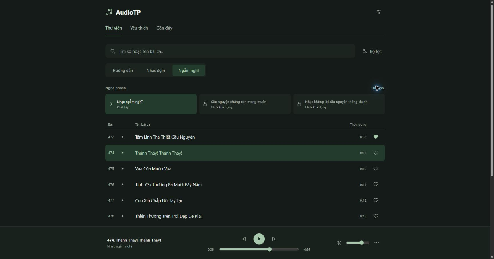

# AudioTP — Nghe nhanh

Ngày 12/10/2026, Asia/Bangkok. Hoàn tất code và kiểm thử local trên Windows/Chrome profile Bang. Chưa build bản EXE mới hoặc kiểm thử Cloudflare live.

## Hành vi đã triển khai

- Hàng Nghe nhanh ngay dưới ba tabs, trên danh sách. Desktop ba cột, mobile ba hàng nhỏ; giữ dark/light. Không thêm sidebar, banner hoặc tab.
- Từ khóa sau trim khác rỗng: ẩn toàn bộ khu vực. Xóa hết: hiện lại theo lựa chọn thu gọn của người dùng. Chuỗi toàn khoảng trắng không được coi là tìm kiếm.
- Thu gọn thủ công được lưu riêng tại `audiotp.quick-collapsed.v1`; không đổi schema yêu thích/lịch sử. Tìm kiếm, đổi tab, timeupdate, seek và reload không tự mở lại phần đã thu gọn.
- Có state tự ẩn độc lập, khôi phục khi đang phát đạt ≥50% và không tìm kiếm/thu gọn thủ công. Tự ẩn dùng visibility + inert để giữ chỗ, không đẩy danh sách. Không tạo một hành vi tự thu gọn mới khi đang nghe; state này hiện dùng lúc tải catalog. Logic khôi phục tự động được unit test, không giả lập một trường hợp UI không tồn tại để tuyên bố browser đã thử.
- Không popup, gọi focus, timer hoặc tự scroll trong luồng Nghe nhanh. Tìm kiếm/thu gọn theo thao tác trực tiếp có thay đổi bố cục; mốc 50% không gây thêm dịch chuyển lớn.

## Đúng asset và thứ tự

`scripts/windows_catalog.py::project_quick_play` ghép snapshot `lists.silentSongList` qua `newsongAudioId` → manifest assetId, xác minh số hiển thị, title chuẩn hóa Unicode/khoảng trắng/casefold và HLS source bằng nhau. Reject thiếu/trùng/sai ID/title/number/source. Không dùng thứ tự map catalog làm thứ tự nguồn.

Queue: 19977, 19976, 19975, 19974, 19973, 19972, 19971, 19970, 19969, 19968, 19967, 19966, 19965. First asset **`watv:vi:silent:19977` — Tâm Linh Tha Thiết Cầu Nguyện**, số hiển thị 472. Nguồn ghi 00:00:49; file/Chrome đo **50.085442 giây**. Đây là shortcut thư viện silent theo yêu cầu mới, không phải kết luận rằng nó tái hiện nguyên bản mục ghim WATV trước đây.

Khi bấm, chuyển về Thư viện + tab Ngẫm nghĩ, bỏ bộ lọc cũ và queue đúng 13 asset. Player chung giữ tên bài thật, highlight asset hiện tại. Bấm mục đang active tạm dừng/phát tiếp, đồng thời vẫn khôi phục đúng view/tab; không reset vị trí hoặc queue. Khi kết thúc, giữ quy tắc stop/continuous/repeat/shuffle của player hiện có. Không tạo audio element hoặc resolver riêng.

## Hai mục cầu nguyện

| Mục | Tình trạng |
|---|---|
| Nhạc ngẫm nghĩ | Có nguồn/quyền của 13 asset hiện có; phát được |
| Cầu nguyện chúng con mong muốn | Chưa khả dụng; assetIds rỗng, source observed-not-imported, rights unknown |
| Nhạc không lời cầu nguyện thống thanh | Chưa khả dụng; assetIds rỗng, source not-imported, rights unknown |

Báo cáo/source HTML cũ đã ghi nhận 14 URL WATV_PRAYER (`our_wish`, `pray_01`–`pray_13`), nằm ngoài snapshot audio/catalog 983. Đối chiếu manifest không có các asset này. Inventory local: **983 file, 983 đường dẫn manifest, 0 missing, 0 extra** trong media; không thấy file prayer riêng. Không lấy một silent khác để thay thế.

Metadata đã hỗ trợ `behavior: asset-playlist`, IDs cụ thể và source/rights gating. Bổ sung về sau cần xác minh nguồn, quyền, identity, file và manifest mở rộng riêng qua pipeline có review; sau đó mới bật available/verified/approved. Không đổi 983 asset gốc hoặc tự nâng rights. Bước này không triển khai CLI nhập prayer, nên không có lệnh tải/upload mới.

## Kiểm thử và bằng chứng

| Kiểm tra | Kết quả |
|---|---|
| Frontend Node | **37 PASS / 0 FAIL / 0 SKIP** |
| Python toàn dự án | **169 tổng: 167 PASS / 0 FAIL / 2 SKIP** (symlink không được phép trên môi trường Windows) |
| Source ordering/gating/invalid snapshot | PASS, bao gồm đảo map catalog không đổi queue, thiếu/trùng/sai ID/title/number |
| State machine | PASS: tìm kiếm/manual ưu tiên, reload preference qua browser, ≥50%, NaN/Infinity/zero duration, paused, seek ngược |
| Chrome thực tế | PASS: search/clear, manual collapse/reload, first 19977, active shortcut sau Guide/Yêu thích, pause/resume/seek, next 19976, previous 19977, ended continuous sang 19976 |
| Ưu tiên sau 50% | PASS: file 19976 ở ~35.75/56.96s vẫn thu gọn; search ẩn, clear vẫn giữ thu gọn; focus search và scrollY 0 được giữ |
| Player/highlight/storage | PASS: một audio element, đúng media path, aria-current asset 19976; lịch sử có bài thật 19977/19976, yêu thích 19977 được giữ |
| Responsive | PASS: CSS 1745×917, 768×1024 và 320×640; 320px dark/light không tràn ngang, player/control không đè lên hàng Nghe nhanh |
| Local integrity | **983/983 SHA-256 và size khớp**, 2,506,137,889 bytes đọc; 5 protected metadata hashes giữ nguyên |

Review độc lập phát hiện early-return khi bấm mục active sau đổi view. Đã đưa bước chọn view/tab trước toggle, kiểm thử lại trên Chrome thành công. Không còn lỗi quan trọng được ghi nhận. Các browser observation đầu có selector đo row/highlight cũ; file bằng chứng ghi rõ lỗi instrumentation và observations sau đã dùng selector thật, không dùng số 0 đó để kết luận thiếu dữ liệu.

Lệnh kiểm thử đã chạy:

```powershell
cd D:\Workspace\AudioTP
.\.venv\Scripts\python.exe -X utf8 -m unittest discover -s tests -v
.\.venv\Scripts\python.exe -X utf8 scripts/prepare-windows.py
cd apps\windows
npm.cmd test
```

Bằng chứng nằm trong `apps/windows/evidence/`: `quick-listening-frontend-tests.txt`, `quick-listening-python-tests.txt`, `quick-listening-integrity.json`, `quick-listening-browser.json`, ba ảnh `quick-listening-desktop-dark.jpg`, `quick-listening-mobile-dark.jpg`, `quick-listening-mobile-light.jpg`. Chỉ ảnh ứng dụng local tự tạo, không chụp BookVN. URL playback trong JSON đã bỏ query vé phát; không đọc credential.



## File tạo/sửa và giới hạn

- Code UI: `apps/windows/web/app.mjs`, `ui-core.mjs`, `index.html`, `styles.css`, generated `quick-play.json`.
- Projection: `scripts/windows_catalog.py`, `scripts/prepare-windows.py`; generator ghi lại `catalog.client.json` cùng nội dung dự kiến, không đổi source catalog/manifest.
- Test: `apps/windows/tests/ui-core.test.mjs`, `tests/test_windows_catalog.py`.
- Docs: báo cáo này, `apps/windows/README.md`, `docs/windows-user-guide.vi.md`, `docs/minimal-player-redesign.md`, `docs/autonomous-implementation-report.md`, ledger `docs/superpowers/plans/2026-10-12-windows-mvp.md`.
- Evidence: các file được liệt kê ở trên. Browser đã khôi phục viewport desktop, dark theme, mở rộng Nghe nhanh và tạm dừng audio sau test.

Không đổi hash audio catalog, delivery manifest, source snapshot, sheet catalog hoặc config R2; không sửa media/state/credential. Không tải audio mới hoặc upload R2. Các kết quả phát là local M4A qua read-only adapter hiện có; không thay thế B10 remote verification hay native WebView2/EXE testing.
