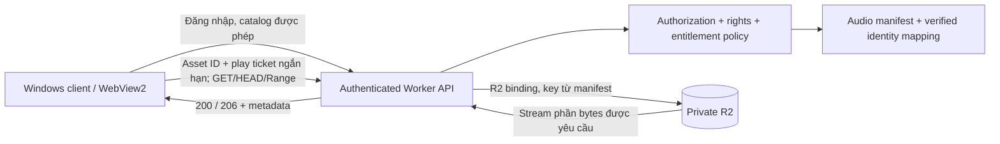

# AudioTP — Kiến trúc ứng dụng Windows đề xuất

**Trạng thái 0.2 — 12/10/2026:** đã triển khai Worker/API source có xác thực + vé phát + R2 allowlist và client Tauri source; đã thử M4A thật qua adapter local và workerd R2 mô phỏng. Chưa deploy hoặc compile EXE vì thiếu toolchain. [Báo cáo hiện hành và blockers](autonomous-implementation-report.md), [Worker/API đã triển khai](../workers/media-api/README.md). Các đoạn “chưa triển khai” bên dưới giữ bối cảnh bản đề xuất ban đầu.

Ngày khảo sát tài liệu: 12/10/2026. **Chỉ phân tích**, chưa tạo app production, Worker/API, public bucket, deployment, credential hoặc quyền phân phối. Quyền lưu cá nhân không tự bật quyền phục vụ nhiều người.

Cập nhật triển khai 12/10/2026: đã có **source MVP/demo** Tauri và giao diện browser với âm mẫu tự tạo trong `apps/windows`. Đây vẫn chưa phải app production hoặc EXE đã build; xem [kết quả thực thi](audiotp-windows-implementation.md) và [hướng dẫn Windows](../apps/windows/README.md). Các đề xuất API/cache bên dưới chưa được triển khai live.

## Lựa chọn công nghệ

Đề xuất **Tauri 2 + giao diện TypeScript gọn + WebView2 Evergreen**, build trên Windows, installer NSIS `setup.exe` ký mã. Đây là khuyến nghị thiết kế dựa trên mục tiêu dung lượng nhỏ và UI web/audio/PDF; chưa có benchmark AudioTP. Không đóng gói Python, FFmpeg hay toàn bộ audio trong EXE.

| Phương án | Dung lượng / runtime | Cập nhật | Bảo mật và caching | Phù hợp AudioTP |
|---|---|---|---|---|
| Tauri 2 + WebView2 | Dùng WebView2 hệ thống; phần app dự kiến nhỏ hơn giải pháp nhúng Chromium, cần đo bản release. Máy thiếu runtime cần cài Evergreen | Updater có chữ ký; Windows code signing là việc riêng | Rust giữ phần xác thực/vault và cache; IPC capabilities nhỏ, CSP, không tải HTML tùy ý | **Ưu tiên** khi dung lượng nhỏ quan trọng và chấp nhận Rust/toolchain |
| WPF .NET + WebView2 hoặc native media | Framework-dependent nhỏ hơn self-contained nhưng cần .NET Desktop Runtime; nếu dùng WebView2 thì thêm runtime đó | MSIX/Store hoặc installer + quy trình updater được review | Tích hợp Windows/vault thuận tiện; cache theo user; không mở bridge tùy ý cho web | Hợp nếu đội phát triển mạnh C# và chỉ nhắm Windows |
| Electron | Nhúng Chromium + Node.js, không phụ thuộc WebView2 riêng; dung lượng/RAM dự kiến cao hơn, cần đo thực tế | Hệ cập nhật desktop sẵn có; cần ký release và quy trình phân phối | Renderer sandbox/contextIsolation, tắt nodeIntegration; cache theo user | Phát triển web nhanh, đổi lại không ưu tiên dung lượng nhỏ |

Tauri hỗ trợ MSI hoặc NSIS setup.exe và nhiều chế độ cài WebView2. Tài liệu ước lượng phần thêm vào installer: download bootstrapper ~0 MB, embed bootstrapper ~1,8 MB, offline installer ~127 MB, fixed runtime ~180 MB; **không phải dung lượng EXE AudioTP**. Chọn bootstrapper/Evergreen cho gói nhỏ; tùy chọn offline riêng nếu cần. [Tauri Windows installer](https://tauri.app/distribute/windows-installer/)

Evergreen là runtime dùng chung, cập nhật tự động; Fixed Version đóng gói riêng và ứng dụng chịu trách nhiệm cập nhật. Không nên cố giữ runtime cũ chỉ để né thay đổi. Đo tổng download lần đầu, installed size app và runtime riêng trên máy sạch; không chỉ đo setup.exe. [Microsoft WebView2 distribution](https://learn.microsoft.com/en-us/microsoft-edge/webview2/concepts/distribution)

.NET framework-dependent cần runtime phù hợp đã cài; self-contained kèm runtime lớn hơn. “Single-file” không tự bảo đảm nhẹ. [Microsoft .NET deployment](https://learn.microsoft.com/en-us/dotnet/core/deploying/)

WPF hiện không hỗ trợ trimming trong .NET SDK theo tài liệu Microsoft; không dùng giả định trimming/AOT để hứa EXE nhỏ. Cần kiểm tra framework/control đã chọn khi làm prototype. [Known trimming incompatibilities](https://learn.microsoft.com/en-us/dotnet/core/deploying/trimming/incompatibilities)

Electron yêu cầu giữ runtime cập nhật, hạn chế navigation/IPC, bật contextIsolation và sandbox, không cho Node integration trong renderer hiển thị nội dung không tin cậy. Lợi thế là runtime đồng nhất; bất lợi dung lượng là suy luận kiến trúc do phải nhúng Chromium/Node, chưa phải phép đo project. [Electron security](https://www.electronjs.org/docs/latest/tutorial/security)

Tauri updater yêu cầu xác minh chữ ký update. Khóa ký update giữ ngoài app/CI public; app chỉ chứa public key. Chữ ký updater và Authenticode/code signing installer có mục đích khác nhau. Chọn x64 trước, ARM64 sau; chỉ chốt Windows version support sau khi kiểm tra runtime/toolchain và vòng đời hỗ trợ hiện hành. [Tauri updater](https://tauri.app/plugin/updater/)

## Luồng private R2 → người dùng

R2 binding cho phép Worker đọc object và hỗ trợ range/conditional options. Không sao chép handler ví dụ có PUT/DELETE thành media API production; thiết kế này chỉ cần read routes. API phải tự thực hiện authentication/authorization trước R2 get, không phải cứ có binding là có kiểm soát truy cập. [Cloudflare R2 Workers API](https://developers.cloudflare.com/r2/api/workers/workers-api-reference/)

Các route sau là **hợp đồng đề xuất, chưa triển khai và không phải lệnh có thể chạy**:

- `GET /v1/catalog`: catalog client gọn, revision/ETag, chỉ bài được user phép nghe; trả song ID, section/number, title, guide/instrumental asset IDs/duration. Không phát nguồn HLS WATV, đường local hoặc credential.
- `POST /v1/play-tickets`: nhận asset ID thuộc catalog cho phép; xác thực user và quyền phục vụ riêng; cấp opaque ticket hết hạn ngắn, chỉ một asset/variant. Không chấp nhận bucket/key do client tùy ý gửi.
- `GET/HEAD /v1/media/<ticket>`: tra ticket/asset manifest, kiểm tra expiry/quyền hiện tại, stream từ private R2. Ticket không phải R2 key và không cấp LIST/write.
- `GET /v1/sheets/...` sau này chỉ khi source có file, mapping verified không stale và quyền serve được xác nhận riêng. Không dùng mapping candidate hoặc quyền restricted để tự cấp file.

Native app đăng nhập qua phương thức chuẩn được chọn ở giai đoạn API (ví dụ authorization code + PKCE trong system browser), giữ refresh/session secret trong OS credential vault/DPAPI, không trong JS localStorage/log. Không nhúng access key/secret R2, shared password hoặc Worker admin token vào EXE. Play ticket ngắn hạn là credential dùng một mục đích: ai có URL có thể dùng trong thời hạn, nên phải redact khỏi logs/telemetry, giới hạn scope và có phương án revoke. Chưa chọn identity provider hoặc cấp session thật.

`<audio src>` không tự thêm Authorization header tùy ý như fetch. Play ticket là lựa chọn thiết kế để audio Range/seek hoạt động; cần prototype expiry/refresh và logout. Không dựa vào third-party cookie cross-origin giữa Tauri origin và API. Khi ticket hết hạn, lấy ticket mới qua native authenticated request, khôi phục `currentTime`; không tải toàn file thành Blob để nghe.

## Nghe, tua và cache

Audio hiện là M4A/AAC có faststart theo manifest B8, phù hợp thử progressive playback. Client tải catalog nhỏ trước; chỉ request media khi user chọn bài/variant. Search theo `(section, number)` và title chuẩn hóa; main/appendix riêng, meditation riêng. UI phát/tạm dừng/tua, nhớ vị trí theo asset ID + revision; đổi guide/instrumental không hứa hai bản có timeline trùng khít vì duration khác nhau.

Worker cần xử lý Range đúng, không chỉ chuyển header xuống R2: full `200`, single-range `206` với Content-Range/Content-Length/Accept-Ranges, invalid/unsatisfiable `416`, HEAD không body; conditional/If-Range/ETag và client refresh phải có tests. Trả Content-Type audio/mp4 và stream body, không buffer cả asset trong Worker. Đây là yêu cầu implementation tương lai, chưa được kiểm chứng bằng playback thật.

Mặc định response private/no-store để tránh shared CDN cache nhầm user. Cache local tùy chọn, bounded theo bytes/LRU, khóa theo asset ID + content hash + user scope; chỉ lưu nếu chính sách cho phép, không prefetch 983 asset. Đăng xuất/revoke cần xóa cache nhạy cảm và vị trí theo policy. SHA-256 toàn file chỉ tính được khi có đủ bytes; range response không được gọi là full-content SHA verified. TLS và manifest pin hỗ trợ kiểm tra đường truyền/phiên bản; không có cơ chế ngăn tuyệt đối người đã nghe ghi lại audio.

Future PDF: viewer bundled được review dependency/license, không tải script viewer từ CDN tùy ý. Lazy-load file được phép, không render BookVN remote image vào app để lách giới hạn. Giữ nhiều ấn bản/source và provenance; mapping identity không tự xác nhận quyền hoặc chất lượng bản in.

## Roadmap đề xuất và tiêu chí qua từng bước

1. **B10 user-run + mapping review:** người dùng chạy audit, gửi summary; review main464/5 cặp phụ lục bằng evidence thật. Chưa deploy. Audit metadata PASS không phải full remote SHA proof.
2. **Policy/API contract:** chốt ai được dùng, quyền phục vụ, provider đăng nhập, session/ticket expiry, cache/revoke/retention, route/Range/errors/schema. Test với manifest/bytes giả; chưa dùng bucket thật.
3. **Desktop prototype offline:** Tauri2/WebView2 với catalog/audio/PDF tự tạo; thử search/variant/pause/seek/resume, ticket expiry giả và offline errors. So đo installer/installed size/RAM/startup trên máy sạch có/không Evergreen. Nếu Rust chi phí cao, benchmark WPF trước khi chốt.
4. **Worker staging được người dùng duyệt riêng:** secret/binding ở server, private bucket, authorization deny-by-default, GET/HEAD/Range tests, throttling và logs redacted. Người dùng tự chạy tác vụ Cloudflare; không biến báo cáo này thành quyền deploy.
5. **Beta phạm vi nhỏ được phép:** user tự kiểm thử mạng chậm, seek đầu/cuối, 401/403/404/416/429/5xx, variant đổi/expiry/logout/revoke, cache riêng user, API compatibility. Không ship credential/source HLS.
6. **Đóng gói và cập nhật:** ký installer/update, update failure/rollback test, x64 rollout có kiểm soát; đo runtime download và disk thật. PDF chỉ sau nguồn/quyền và integrity PASS. Không public bucket.

Chưa cài Tauri/Rust/.NET/Electron, chưa tạo app skeleton hoặc CLI build giả. Việc lựa chọn cuối cùng và deploy thuộc giai đoạn sau, dựa trên benchmark prototype và quyền phục vụ được xác nhận.

## Bổ sung thử nghiệm viewer — 12/10/2026

Đã có [prototype benchmark A/B/C](score-viewer-benchmark.md) bằng fixture tự soạn: PDF vector, PNG/WebP/AVIF và SVG + HTML text. Chạy Chrome thực tế, chưa phải Tauri/WebView2. Kết quả dung lượng/chất lượng hỗ trợ hướng hybrid theo nguồn; số đo thời gian có nhiễu scheduling nên chưa chốt công nghệ desktop hay hiệu năng native từ thử nghiệm này. Roadmap prototype ở trên vẫn cần đo WebView2/installer/RAM trên máy mục tiêu.
